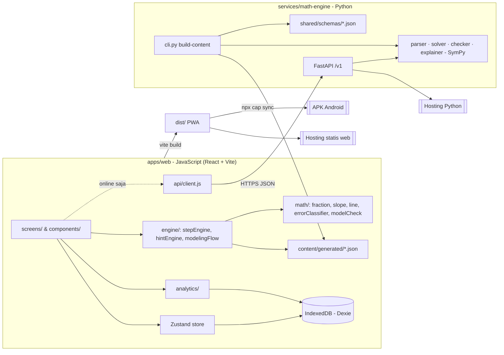

# Arsitektur Teknis

## 1. Gambaran Umum

Proyek menggunakan **dua bahasa**:
- **JavaScript**: aplikasi siswa (web PWA + Android lewat Capacitor), pemeriksaan jawaban offline, grafik interaktif.
- **Python**: mesin matematika dan pemodelan soal cerita (SymPy), pembangun bank soal, dan API untuk soal cerita bebas.



**Prinsip:**
1. **Offline-first.** Materi, latihan gradien, dan seluruh bank soal cerita berjalan tanpa internet. Bank soal sudah diselesaikan dan diverifikasi Python saat *build*.
2. **Python adalah acuan kebenaran matematika.** JavaScript hanya memeriksa jawaban terhadap data hasil Python dan memakai vektor uji bersama.
3. **API hanya untuk fitur tambahan** (F-31: soal cerita yang diketik bebas). Jika offline, fitur ini dinonaktifkan dengan pesan yang jelas.

## 2. Struktur Repositori (monorepo)

```
gradiekan/
├─ apps/
│  └─ web/                        # JavaScript
│     ├─ src/
│     │  ├─ app/                  App.jsx, router.jsx, providers.jsx
│     │  ├─ screens/              OnboardingScreen.jsx, HomeScreen.jsx, LessonScreen.jsx,
│     │  │                        PracticeScreen.jsx, ModelingScreen.jsx, ...
│     │  ├─ features/
│     │  │  ├─ onboarding/ recap/ lesson/ practice/ hints/ analog-example/ reflection/ research/
│     │  │  └─ modeling/          F-24–F-33: ModelingStepper, VariableBuilder, MultiRepresentation,
│     │  │                        InterpretForm, ReasonablenessCheck, ContextGlossary, FreeInput, PosingStudio
│     │  ├─ components/
│     │  │  ├─ ui/                Button, Card, Sheet, ProgressBar, FeedbackBanner, KeyPoint, HelpBar
│     │  │  ├─ cartesian/         CartesianPlane, DraggablePoint, LineSegment, RiseRunOverlay, SlopeSlider
│     │  │  ├─ math/              MathText, ColoredVar, FractionView, NumberLine, ValueTable
│     │  │  └─ steps/             StepRunner, KnownAskedForm, MicroStep, NumericKeypad, EquationInput
│     │  ├─ math/                 fraction.js, slope.js, line.js, generator.js, errorClassifier.js, modelCheck.js
│     │  ├─ engine/               stepEngine.js, hintEngine.js, modelingFlow.js, progress.js
│     │  ├─ content/
│     │  │  ├─ modules/           M0–M8 (materi, ditulis manusia)
│     │  │  ├─ generated/         ← DIHASILKAN Python, jangan diedit manual
│     │  │  └─ strings.id.js
│     │  ├─ api/                  client.js (fetch ke math-engine, timeout, offline detection)
│     │  ├─ analytics/            events.js, db.js, export.js
│     │  ├─ store/                useSettings.js, useProgress.js, useSession.js
│     │  └─ styles/               tokens.js, globals.css
│     ├─ tests/                   unit (Vitest) + e2e (Playwright)
│     ├─ android/                 dibuat Capacitor
│     ├─ capacitor.config.json
│     ├─ vite.config.js
│     └─ package.json
├─ services/
│  └─ math-engine/                # Python (lihat MODELING_ENGINE.md §3)
│     ├─ mathengine/
│     ├─ tests/
│     └─ pyproject.toml
├─ content/
│  └─ problems/                   # sumber soal cerita (YAML) yang ditulis guru/peneliti
├─ shared/
│  ├─ schemas/                    # JSON Schema (diekspor dari Pydantic)
│  └─ test-vectors/               # kasus uji bersama JS ↔ Python
├─ docs/
└─ package.json                   # skrip gabungan (dev:web, dev:api, build:content, test:all)
```

## 3. Bagian JavaScript (`apps/web`)

### 3.1 Bahasa dan konvensi
- **JavaScript modern (ES2022) + JSX.** Tidak memakai TypeScript.
- Bentuk data dideskripsikan dengan **JSDoc** (`@typedef`) dan divalidasi saat runtime dengan **Ajv** terhadap JSON Schema di `shared/schemas/`.
- Opsional: `// @ts-check` di file `src/math/` agar editor VS Code memeriksa tipe dari JSDoc.

### 3.2 `math/` (murni, 100% teruji)
```js
/** @typedef {{num: number, den: number}} Fraction  // selalu sederhana, den > 0 */
fraction(n, d)                 // normalisasi & sederhanakan; d = 0 → throw
equals(a, b)
parseAnswer(input)             // "3/2", "-7/3", "1,5", "Rp25.000", "tak terdefinisi"
slopeFromPoints(p1, p2)
slopeFromEquation(eq)
perpendicularSlope(m)
classifyError(ctx)             // CONTENT_SPEC §8
modelCheck(problem, input)     // cocokkan model/jawaban siswa dengan accepted_forms & nilai hasil Python
```
Pemeriksaan jawaban **selalu** memakai pecahan eksak, bukan desimal.

### 3.3 `engine/`
- `stepEngine.js`: mesin keadaan per soal (`idle → active → checking → correct/incorrect → … → done`).
- `hintEngine.js`: *hint* 3 tingkat + *fading*.
- `modelingFlow.js`: mesin keadaan siklus pemodelan 5 tahap (Pahami → Rumuskan → Selesaikan → Tafsirkan → Periksa), dengan kemungkinan kembali ke Rumuskan bila hasil tidak wajar.

### 3.4 `api/client.js`
- `parseProblem(text)`, `solveProblem(problem)`, `checkModel(...)`.
- *Timeout* 8 detik; deteksi offline (`navigator.onLine` + *health check*); pesan ramah bila gagal.
- URL API dari variabel lingkungan `VITE_API_URL`.

## 4. Bagian Python (`services/math-engine`)

Rincian lengkap ada di [MODELING_ENGINE.md](MODELING_ENGINE.md). Ringkasnya:

| Modul | Tugas |
|---|---|
| `schemas.py` | Model data Pydantic → sumber JSON Schema |
| `linear.py`, `solver.py` | Penyelesaian model linear eksak (SymPy) |
| `checker.py` | Diagnosis kesalahan pemodelan |
| `explainer.py` | Langkah, *hint*, micro-step bahasa Indonesia |
| `parser/` | Soal cerita bahasa Indonesia → kandidat model |
| `generator.py` | Variasi angka soal deterministik |
| `cli.py` | `build-content`, `validate`, `export-schemas` |
| `api.py` | FastAPI `/v1/parse`, `/v1/solve`, `/v1/check`, `/v1/explain` |

## 5. Model Data Utama (JSDoc, mencerminkan Pydantic)

```js
/** @typedef {'M0'|'M1'|'M2'|'M3'|'M4'|'M5'|'M6'|'M7'|'M8'} ModuleId */

/** @typedef {Object} Problem   // soal gradien (M2–M6)
 * @property {string} id
 * @property {'two-points'|'from-graph'|'from-equation'|'parallel'|'perpendicular'|'direction'} type
 * @property {1|2|3|4} level
 * @property {string[]} tags
 * @property {string} stem
 * @property {Record<string, number>} params
 * @property {Step[]} steps
 */

/** @typedef {Object} WordProblem   // soal cerita (M7–M8), dihasilkan Python
 * @property {string} id
 * @property {'T1'|'T2'|'T3'|'T4'|'T5'|'T6'|'T7'|'T8'|'T9'|'T10'} type
 * @property {'personal'|'sosial-budaya'|'saintifik'} context
 * @property {'K-A'|'K-B'|'K-C'|'K-D'} contextLevel
 * @property {'pemahaman'|'penerapan'|'penalaran'} cognitiveLevel
 * @property {string} text
 * @property {Object|null} stimulus
 * @property {{known: number[][], asked: number[][], distractor: number[][]}} annotations
 * @property {LinearModel[]} models
 * @property {Solution} solution
 */

/** @typedef {Object} AnalyticsEvent
 * @property {number} ts
 * @property {string} sessionId
 * @property {string} [participantCode]
 * @property {string} appVersion
 * @property {'web'|'android'} platform
 * @property {string} type
 */
```

### Skema IndexedDB (Dexie)
```js
db.version(1).stores({
  progress: 'moduleId',
  notes: '++id, moduleId, createdAt',
  posedProblems: '++id, createdAt',   // F-33 soal buatan siswa
  events: '++id, ts, sessionId, type, participantCode',
  kv: 'key'
});
```

## 6. Build dan Rilis

| Target | Perintah | Keluaran |
|---|---|---|
| Bangun bank soal | `npm run build:content` (memanggil `python -m mathengine.cli build-content`) | `apps/web/src/content/generated/` |
| Web dev | `npm run dev:web` | localhost:5173 |
| API dev | `npm run dev:api` (memanggil `uvicorn mathengine.api:app --reload`) | localhost:8000/docs |
| Web produksi | `npm run build:web` | `apps/web/dist/` (PWA) |
| Android | `npm run build:web && npx cap sync android` lalu Android Studio | APK/AAB |
| API produksi | Docker image `services/math-engine/Dockerfile` | Hosting Python (mis. Render, Railway, Fly.io, atau server kampus) |

- `capacitor.config.json`: `appId: "id.ac.<kampus>.gradiekan"`, `webDir: "dist"`; `minSdkVersion` 26.
- Plugin Capacitor: `@capacitor/share`, `@capacitor/filesystem`, `@capacitor/app`, `@capacitor/network`.
- CI (GitHub Actions): job **python** (ruff, pytest, build-content, cek tidak ada perubahan pada `generated/`) dan job **web** (eslint, vitest, build).

## 7. Kualitas dan Performa

- *Code splitting* per rute; KaTeX dimuat secara *lazy*.
- Bank soal hasil build dipecah per modul (dimuat saat modul dibuka).
- Total aset web ≤ 3 MB; APK ≤ 15 MB.

## 8. Keputusan Teknis (ADR Ringkas)

| # | Keputusan | Alasan | Alternatif yang ditolak |
|---|---|---|---|
| ADR-01 | JavaScript (React + Vite) + Capacitor untuk aplikasi | Diminta pemilik proyek; satu kode untuk web & Android | TypeScript (menambah kurva belajar), Flutter |
| ADR-02 | Offline-first; API hanya untuk fitur tambahan | Sekolah dengan internet terbatas; privasi siswa | Semua logika di server |
| ADR-03 | Grafik SVG buatan sendiri | Kontrol penuh atas *snap*, warna peran, *rise/run*; ringan | GeoGebra embed (berat, UI ramai) |
| ADR-04 | Aritmetika pecahan eksak (JS) dan `sympy.Rational` (Python) | Menghindari kesalahan pembulatan | Desimal |
| ADR-05 | Konten soal cerita ditulis di YAML, dibangun Python | Guru dapat menulis soal; solusi & langkah dibuat dan diverifikasi otomatis | Menulis solusi manual di JSON |
| ADR-06 | Zustand + Dexie | Ringan; IndexedDB tersedia di WebView | Redux; `localStorage` |
| ADR-07 | Python + SymPy untuk mesin pemodelan | Diminta pemilik proyek; SymPy unggul untuk aljabar simbolik & kesetaraan persamaan | Menulis aljabar simbolik sendiri di JS |
| ADR-08 | Parser soal cerita berbasis aturan (tanpa AI) | Dapat dijelaskan, gratis, deterministik, tanpa mengirim data ke pihak ketiga | LLM (biaya, privasi, tidak deterministik). Ditinjau ulang pada v2 |
| ADR-09 | Mesin Python berjalan di server/build-time, bukan di perangkat | Pyodide + SymPy menambah unduhan ± 10–20 MB, melebihi batas APK/bundle | Pyodide di WebView |
| ADR-10 | Pydantic sebagai sumber tunggal skema → JSON Schema → Ajv | Mencegah perbedaan struktur data antarbahasa | Mendefinisikan skema dua kali |

Tambahkan ADR baru setiap kali menambah dependensi besar atau mengubah arsitektur.
