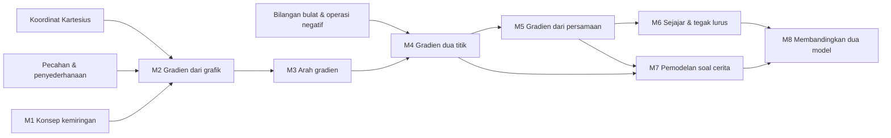

# Spesifikasi Konten Pembelajaran

## 1. Posisi Kurikulum

- **Kurikulum:** Kurikulum Merdeka, **Fase D** (SMP kelas VII–IX), elemen **Aljabar** (relasi, fungsi, dan persamaan garis lurus).
- **Kelas sasaran:** VIII. Materi ini juga dapat dipakai untuk pengayaan atau remedial kelas IX.
- **Rujukan bahan:** Buku Matematika SMP Kelas 8 (Penerbit MKP) dan LKS Matematika Kelas VIII yang dipakai narasumber.
- ⚠ Sebelum konten final, cocokkan rumusan Capaian Pembelajaran dengan dokumen resmi CP terbaru dari BSKAP Kemendikbudristek, serta notasi dengan buku sekolah (`c` atau `b`).

## 2. Tujuan Pembelajaran (TP)

Setelah menggunakan aplikasi, siswa dapat:

| TP | Rumusan | Modul |
|---|---|---|
| TP-0 | Menghitung penjumlahan/pengurangan bilangan bulat negatif, membaca koordinat Kartesius, dan menyederhanakan pecahan | M0 |
| TP-1 | Menjelaskan makna kemiringan dalam konteks sehari-hari | M1 |
| TP-2 | Menentukan gradien garis dari grafik menggunakan perbandingan Δy/Δx | M2 |
| TP-3 | Mengaitkan tanda gradien dengan arah garis (positif, negatif, nol, tak terdefinisi) | M3 |
| TP-4 | Menghitung gradien garis yang melalui dua titik | M4 |
| TP-5 | Menentukan gradien dari persamaan `y = mx + c` dan `ax + by + c = 0` | M5 |
| TP-6 | Menentukan gradien garis yang sejajar dan tegak lurus dengan garis lain | M6 |
| TP-7 | Memaknai gradien sebagai laju perubahan dan konstanta sebagai nilai awal dalam konteks nyata | M7 |
| TP-8 | Memodelkan soal cerita ke dalam bentuk `y = mx + c` dengan menentukan variabel dan satuannya | M7 |
| TP-9 | Menyelesaikan model (prediksi dan invers) serta menafsirkan dan mengevaluasi hasilnya dalam konteks | M7 |
| TP-10 | Membandingkan dua model linear untuk mengambil keputusan dalam konteks | M8 |

## 3. Peta Prasyarat



Soal kontekstual singkat (level K-A/K-B) juga **disisipkan di M1–M6** agar literasi tumbuh sejak awal. Contohnya, M2 memuat kemiringan tangga dan M4 memuat dua data harga.

M0 (Cek Prasyarat) **direkomendasikan** sebelum M2 tetapi tidak dikunci (F-21). Jika skor M0 < 60%, aplikasi menyarankan latihan prasyarat tanpa memaksa.

## 4. Urutan Modul dan Chunk

Setiap modul mengikuti pola tetap: **Recap → Materi (chunks) → Contoh → Latihan → Refleksi → Poin Inti**.

### M0 Cek Prasyarat (± 5 menit, opsional)
1. Garis bilangan: lompat kanan/kiri.
2. Kurang negatif = tambah: `3 − (−2)`.
3. Membaca titik di bidang Kartesius.
4. Menyederhanakan pecahan: `6/4 → 3/2`.
5. Kuis 8 soal.

### M1 Apa itu Kemiringan (± 5 menit)
1. Foto/ilustrasi tangga, jalan menanjak, perosotan: "Mana yang paling curam?"
2. Kemiringan = seberapa naik dibanding seberapa jauh berjalan.
3. Dua tangga: naik sama, jarak berbeda. Mana lebih curam?
4. ⭐ Poin inti: "Kemiringan = naik ÷ jalan."

### M2 Gradien dari Grafik (± 10 menit)
1. Grafik dengan dua titik di grid, lalu hitung kotak "jalan" ke kanan (Δx).
2. Hitung kotak "naik" (Δy).
3. ⭐ `m = Δy / Δx` dengan visual *rise/run* (F-06).
4. Gradien pecahan: "jalan 3, naik 2" → `2/3`.
5. Contoh (F-02), lalu latihan dengan menggambar (F-14).

### M3 Arah Gradien (± 8 menit)
1. Eksplorasi slider m (F-07).
2. ⭐ m > 0 naik, m < 0 turun.
3. m = 0 → garis mendatar (Δy = 0).
4. Garis tegak: Δx = 0 → gradien **tidak terdefinisi** (pembagian dengan nol).
5. Tantangan "Tebak Arah".

### M4 Gradien dari Dua Titik (± 15 menit), modul inti
1. Dari grafik ke rumus: Δy = y₂ − y₁, Δx = x₂ − x₁.
2. ⭐ `m = (y₂ − y₁) / (x₂ − x₁)` dengan warna titik.
3. Boleh menukar titik 1 dan 2 asalkan konsisten.
4. Contoh 1: semua positif. Contoh 2: ada negatif (micro-step F-20).
5. Latihan bertingkat L1 → L4.

### M5 Gradien dari Persamaan (± 12 menit)
1. Slider m dan c (F-07): c menggeser garis, m memiringkan garis.
2. ⭐ Pada `y = mx + c`, gradien adalah angka yang menempel pada x.
3. Bentuk tidak baku: `y = 3 − 2x`, `2y = 4x + 6`, diubah dengan micro-step.
4. Bentuk `ax + by + c = 0` → ⭐ `m = −a/b`.
5. Perbandingan side-by-side (F-08).

### M6 Sejajar dan Tegak Lurus (± 12 menit)
1. Dua garis sejajar di grafik: geser satu garis dan lihat gradiennya.
2. ⭐ Sejajar: `m₁ = m₂`.
3. Putar garis 90° di grafik: amati gradien.
4. ⭐ Tegak lurus: `m₁ × m₂ = −1`, sehingga `m₂ = −1/m₁` ("dibalik dan diganti tanda").
5. Latihan menggambar garis sejajar/tegak lurus (F-14).

### M7 Pemodelan Soal Cerita (± 25 menit, dapat dibagi 2 sesi)
Prasyarat: M4 dan M5. Kerangka lengkap ada di [MATH_LITERACY.md](MATH_LITERACY.md).
1. "Gradien itu laju": contoh tarif ojek per km, harga per kg, tanaman tumbuh per minggu. ⭐ "m = berapa banyak y berubah untuk setiap 1 x."
2. "c itu nilai awal": biaya buka pintu, tabungan awal. ⭐ "c = nilai y saat x = 0."
3. Kenalan dengan siklus 5 tahap (F-24) lewat satu contoh lengkap (F-02).
4. Variabel & satuan (F-25): mana yang mempengaruhi, mana yang dipengaruhi.
5. Satu cerita, empat wajah: cerita ↔ tabel ↔ grafik ↔ persamaan (F-26).
6. Laju menurun (m < 0): bensin, suhu malam.
7. Kemiringan fisik: tangga, ramp kursi roda, persen kemiringan jalan.
8. Soal invers: "kapan/berapa jauh …?"
9. Latihan bertingkat T1–T8, konteks K-A → K-C (F-30).
10. Refleksi: "Ceritakan arti m dan c pada soal favoritmu" (F-17) atau Buat Soal Ceritaku (F-33).

### M8 Membandingkan Dua Model (± 15 menit)
1. Dua paket internet/ojek: tabel dan grafik dua garis.
2. ⭐ "Saat dua garis berpotongan, biayanya sama."
3. Menyamakan dua model: `m₁x + c₁ = m₂x + c₂` (micro-step).
4. Menafsirkan: "Untuk jarak di bawah … km, paket A lebih murah."
5. Sejajar/tegak lurus dalam konteks (T10).
6. Soal K-D: memberi keputusan dan alasan (uraian, rubrik).

### Latihan Campuran dan Evaluasi
- 10 soal campuran dari M2–M8 (minimal 4 soal cerita), dengan semua bantuan tetap tersedia.
- Mode "Tantangan" (opsional): bantuan diciutkan secara default.
- **Tes Literasi** (mode riset): 10–12 soal bergaya AKM tanpa bantuan untuk pretest/posttest ([ANALYTICS_RESEARCH_PLAN §3](ANALYTICS_RESEARCH_PLAN.md)).

## 5. Tingkat Kesulitan Soal

Tingkat kesulitan disusun berdasarkan **jumlah unsur negatif dan pecahan** (IL01, IL03, IL04):

| Level | Ciri | Contoh |
|---|---|---|
| L1 | Semua koordinat positif, m bilangan bulat positif | A(1,2), B(3,6) → m = 2 |
| L2 | Satu koordinat negatif, atau m negatif bulat | A(−1,4), B(2,−2) → m = −2 |
| L3 | m berupa pecahan (perlu penyederhanaan) | A(0,1), B(4,4) → m = 3/4 |
| L4 | Banyak negatif + pecahan, atau soal cerita | A(−3,−1), B(−6,5) → m = −2; soal cerita jalan menanjak |

## 6. Generator Soal

Fungsi `generateTwoPointProblem(level, seed)` di `apps/web/src/math/generator.js` (soal gradien, dibuat di perangkat). Variasi soal cerita dibuat oleh `mathengine/generator.py` saat build:

- Koordinat dalam rentang −8..8 agar muat di grafik.
- Batasan per level:
  - L1: x₁ < x₂, semua ≥ 0, `Δy % Δx == 0`, m > 0.
  - L2: tepat 1–2 koordinat negatif, `Δy % Δx == 0`.
  - L3: `Δy % Δx != 0`, `|den| ≤ 6` setelah disederhanakan.
  - L4: ≥ 3 koordinat negatif, atau pecahan dengan negatif.
- Tolak: Δx = 0 (kecuali soal khusus "tak terdefinisi" di M3), titik kembar, garis di luar tampilan.
- Deterministik berdasarkan `seed` agar soal dapat direproduksi untuk riset.
- Ada generator serupa untuk persamaan (`generateEquationProblem`) dan sejajar/tegak lurus.

## 7. Format Data Konten (JSON)

### 7.1 Modul dan chunk
```json
{
  "id": "M4",
  "title": "Gradien dari Dua Titik",
  "objectives": ["TP-4"],
  "recap": { "image": "recap-cartesian", "formula": "m = \\frac{y_2 - y_1}{x_2 - x_1}", "keyPoint": "Gradien = selisih y dibagi selisih x" },
  "chunks": [
    {
      "id": "M4-c1",
      "visual": { "type": "cartesian", "points": [[1,2],[4,5]], "showRiseRun": true },
      "text": ["Dari titik biru ke titik oranye, kita jalan 3 ke kanan dan naik 3."],
      "formula": null,
      "keyPoint": null
    }
  ],
  "examples": ["EX-M4-1", "EX-M4-2"],
  "practiceSets": ["PS-M4-1"],
  "reflectionPrompts": ["RP-M4-1"]
}
```

### 7.2 Soal
```json
{
  "id": "P-M4-007",
  "type": "two-points",
  "level": 2,
  "tags": ["two-points", "negative-dy"],
  "stem": "Tentukan gradien garis yang melalui A({x1}, {y1}) dan B({x2}, {y2}).",
  "params": { "x1": -1, "y1": 4, "x2": 2, "y2": -2 },
  "story": null,
  "annotations": { "known": [[34, 45], [50, 61]], "asked": [[0, 16]] },
  "steps": [
    { "id": "known", "kind": "known-asked" },
    { "id": "dy", "kind": "numeric", "expr": "y2 - y1",
      "hints": ["Δy adalah selisih nilai y: y₂ − y₁.", "Δy = {y2} − ({y1})", "{y2} − ({y1}) = {y2} + … "],
      "microSteps": ["{y2} - ({y1})", "{y2} + {neg_y1}", "{dy}"] },
    { "id": "dx", "kind": "numeric", "expr": "x2 - x1", "hints": ["…", "…", "…"] },
    { "id": "m", "kind": "fraction", "expr": "dy / dx", "hints": ["…", "…", "…"] },
    { "id": "check", "kind": "visual-validation" }
  ],
  "analogExampleTags": ["two-points", "negative-dy"],
  "reflectionPromptId": null
}
```

### 7.3 Prompt refleksi
```json
{ "id": "RP-M4-1", "prompt": "Bayangkan temanmu bingung. Jelaskan kenapa gradien garis ini negatif.",
  "wordTiles": ["garisnya", "turun", "naik", "dari kiri ke kanan", "karena", "Δy", "negatif", "positif"],
  "modelAnswer": "Gradiennya negatif karena garisnya turun dari kiri ke kanan: Δy negatif sedangkan Δx positif." }
```

### 7.4 Soal cerita (M7–M8)
Soal cerita **ditulis dalam YAML** di `content/problems/` lalu dibangun oleh Python (`npm run build:content`) menjadi JSON lengkap dengan solusi, langkah, *hint*, `accepted_forms`, dan variasi angka. Format sumber dan hasilnya dijelaskan di [MODELING_ENGINE §4 dan §8](MODELING_ENGINE.md).

Kriteria penulisan soal cerita:
- Konteks nyata dan dekat dengan siswa Indonesia; angka realistis (harga, jarak, waktu).
- Setiap soal memiliki `type` (T1–T10), `context`, `context_level`, `cognitive_level`, serta anotasi `known`, `asked`, dan (untuk K-C/K-D) `distractor`.
- Kalimat ≤ 25 kata; level K-A ≤ 2 kalimat, K-B ≤ 4 kalimat.
- Hindari stereotip gender/suku; variasikan nama tokoh dan daerah.
- Istilah khusus didaftarkan di `content/glossary.yaml` (F-32).

### 7.5 Validasi
Skema materi (JSON) dan soal cerita (YAML) didefinisikan dengan **Pydantic** di `services/math-engine/mathengine/schemas.py`, lalu diekspor ke JSON Schema di `shared/schemas/` untuk divalidasi **Ajv** di JavaScript. Linter konten (Python, dijalankan oleh `build-content`) memeriksa batas *chunk* (F-09), setiap langkah memiliki 3 *hint*, dan teks ≤ 25 kata per kalimat.

## 8. Miskonsepsi dan Umpan Balik

Diklasifikasikan oleh `apps/web/src/math/errorClassifier.js`. Kesalahan khusus pemodelan soal cerita (mis. `RATE_INITIAL_SWAP`, `MISSING_INITIAL`, `UNIT_MISMATCH`) tercantum di [MODELING_ENGINE §7](MODELING_ENGINE.md).

| Kode | Miskonsepsi / kesalahan | Deteksi | Umpan balik |
|---|---|---|---|
| `SIGN_ERROR` | Salah tanda pada pengurangan negatif | \|jawaban\| = \|benar\|, tanda berbeda | "Hampir! Cek tandanya. Kurang negatif sama dengan tambah." |
| `INVERTED_RATIO` | Menghitung Δx/Δy | jawaban = 1/benar | "Ingat: naik dibagi jalan. Δy di atas, Δx di bawah." |
| `MIXED_ORDER` | (y₂ − y₁)/(x₁ − x₂) | jawaban = −benar dan Δx/Δy yang diisi berlawanan urutan | "Urutan titiknya harus sama di atas dan di bawah." |
| `SWAP_POINTS` | x dan y diambil dari titik berbeda | dari isian Known | "Pastikan x₁ dan y₁ berasal dari titik yang sama." |
| `NOT_SIMPLIFIED` | Pecahan belum sederhana | nilai sama, bentuk berbeda | Diterima. "Benar! Bisa disederhanakan jadi …" |
| `ARITH_ERROR` | Salah hitung lain | selain di atas | "Belum tepat. Coba 🔢 Hitung pelan-pelan." |
| `READ_GRAPH` | Salah membaca koordinat | titik di-*plot* bergeser ±1 | "Hitung lagi kotaknya dari titik (0,0)." |
| `M_C_CONFUSION` | Menganggap c sebagai gradien | jawaban = c | "Itu c (titik potong sumbu y). Gradien adalah angka di depan x." |
| `PERP_NO_SIGN` | Tegak lurus: hanya dibalik, tanpa ganti tanda | jawaban = 1/m₁ | "Dibalik sudah benar, tapi tandanya juga harus diganti." |
| `UNDEFINED_AS_ZERO` | Garis tegak dianggap m = 0 | Δx = 0, jawaban 0 | "Garis datar m = 0. Garis tegak tidak punya gradien (dibagi 0)." |

## 9. Gaya Bahasa

- Bahasa Indonesia baku yang ramah, menyapa dengan "kamu".
- Kalimat ≤ 25 kata; satu ide per kalimat.
- Hindari istilah yang belum dikenalkan. Saat istilah baru muncul pertama kali, tampilkan definisinya dengan *tap-to-define*.
- Umpan balik dimulai dengan apresiasi usaha ("Hampir!", "Bagus!") dan diikuti langkah perbaikan yang konkret.
- Konsisten: selalu "gradien" (sebutkan sekali bahwa sinonimnya "kemiringan"); "titik 1 / titik 2", bukan campuran "titik A / titik pertama".
