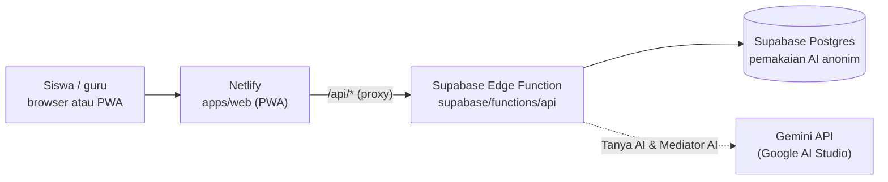

# Deployment: Netlify (frontend) + Supabase (backend & database)



- **Netlify** menyajikan PWA dan meneruskan `/api/*` ke Supabase (`netlify.toml`). Situs tetap satu domain: tanpa masalah CORS, dan cache offline tetap jalan.
- **Supabase Edge Function `api`** adalah backend online (TypeScript, Deno, Hono). Endpoint dan bentuk JSON-nya sama dengan server Python (`/v1/ask`, `/v1/ask/status`), jadi frontend tidak perlu diubah.
- **Supabase Postgres** hanya menyimpan **pemakaian AI tanpa identitas**: kuota harian, anggaran bulanan, dan jumlah permintaan per fase RMT. Pertanyaan siswa tidak disimpan. Progres dan catatan tetap di HP siswa (CLAUDE.md §7). Semua tabel memakai RLS tanpa *policy*, jadi Data API publik Supabase tidak bisa membacanya.

Edge Function hanya menjalankan TypeScript, bukan Python. Bagian yang dipakai saat aplikasi berjalan diporting ke TypeScript. Bagian Python lain tetap dipakai saat *build* dan di lokal:

| Bagian | Di mana | Keterangan |
|---|---|---|
| Materi, latihan, soal cerita, pemeriksa jawaban | Frontend (offline) | Bank soal hasil Python sudah ter-commit di `apps/web/src/content/generated/` |
| Tanya AI + Mediator AI (F-34, F-35) | Edge Function `api` → **Gemini** | Port dari `mathengine/tutor.py` (`ai/prompt.ts` = prompt yang sama + peran mediator RMT) |
| Mesin matematika Python (SymPy, parser, solver) | Lokal / *build-time* | `npm run build:content` sebelum commit bila soal berubah |

---

## 1. Supabase: proyek dan database

1. Daftar di <https://supabase.com> (bisa dengan akun GitHub) → **New project** → nama `gradiekan`, region **Southeast Asia (Singapore)**. Simpan password database di tempat aman.
2. Catat **Project ref** (Project Settings → General), mis. `abcdefghijklmnopqrst`.
3. Dari folder repositori (Supabase CLI sudah terpasang lewat `npm install`):

   ```bash
   npx supabase login                               # sekali, lewat browser
   npx supabase link --project-ref <PROJECT_REF>    # meminta password database
   npm run db:push                                  # membuat tabel dari supabase/migrations/
   ```

## 2. Supabase: deploy backend (Edge Function `api`)

1. Atur *secret* (sekali; nilainya tidak disimpan di repositori). Ketik sendiri di terminal, jangan dibagikan:

   ```bash
   npx supabase secrets set USAGE_SALT=<string-acak-minimal-16-karakter>
   npx supabase secrets set GEMINI_API_KEY=<kunci-dari-Google-AI-Studio>
   # opsional (nilai bawaan di tabel bawah):
   npx supabase secrets set AI_DAILY_QUOTA=30 AI_MONTHLY_BUDGET_USD=5
   ```

   String acak bisa dibuat dengan `node -e "console.log(require('crypto').randomBytes(24).toString('base64url'))"`.
   Kunci Gemini dibuat di <https://aistudio.google.com/apikey>. Koneksi database (`SUPABASE_DB_URL`) disediakan Supabase otomatis.
2. Deploy:

   ```bash
   npm run api:deploy
   ```

   Perintah ini menjalankan `supabase functions deploy api --no-verify-jwt`. Aplikasi tidak memakai Supabase Auth (siswa anonim), jadi pemeriksaan JWT bawaan dimatikan. Fungsi tetap dijaga oleh validasi ketat, kuota harian, dan anggaran bulanan.
3. Cek di browser: `https://<PROJECT_REF>.supabase.co/functions/v1/api/v1/health` → `{"ok":true,"ai_configured":true}`.
4. Ganti `GANTI-PROJECT-REF` di `netlify.toml` (bagian `[[redirects]] from = "/api/*"`) dengan project ref, lalu commit dan push.

## 3. Netlify: deploy frontend

1. Daftar di <https://app.netlify.com> dengan akun GitHub.
2. **Add new site → Import an existing project → GitHub** → pilih repositori `2225250059_Eka_Elsanti`.
3. Netlify membaca `netlify.toml` (base folder utama, perintah `npm run build:web`, folder `apps/web/dist`). Tidak perlu mengisi apa pun, klik **Deploy**.
4. (Opsional) **Site configuration → Change site name** → mis. `gradiekan` → `https://gradiekan.netlify.app`.

Setiap push ke GitHub memicu deploy ulang frontend otomatis. Backend dideploy ulang dengan `npm run api:deploy`.

## 4. Uji setelah deploy

1. Buka situs Netlify → masuk sebagai Siswa (PIN `siswa1234`).
2. Buka **Tanya AI** → tanyakan sesuatu yang tidak ada di bank jawaban → muncul jawaban bertanda "✨ Dijawab Gradi AI".
3. Buka **Materi → Jalur RMT** → **Tanya Mediator AI** → Gradi menjawab dengan pertanyaan penuntun.
4. Supabase → Table Editor → `ai_requests` → ada baris baru (tanpa teks pertanyaan).
5. Di HP: buka situs di Chrome → **Pasang**; di iPhone: Safari → Bagikan → **Tambah ke Layar Utama**.

## Variabel lingkungan (Supabase secrets)

Produksi membaca *secret* Supabase (`npx supabase secrets set NAMA=nilai`). Lokal (`npm run api:dev`) membaca file `.env` di folder utama (lihat `.env.example`).

| Variabel | Bawaan | Keterangan |
|---|---|---|
| `USAGE_SALT` | nilai dev | **Wajib** di produksi (≥ 16 karakter acak). Garam untuk hash anonim alamat IP (kuota harian) |
| `GEMINI_API_KEY` | kosong | Kunci Google AI Studio. Kosong = AI mati, aplikasi tetap jalan dengan bank jawaban offline |
| `GEMINI_MODEL` | `gemini-3.5-flash-lite` | Model utama (sama dengan proyek rujukan). Ganti bila Google mengubah nama model |
| `GEMINI_FALLBACK_MODEL` | `gemini-3.8-flash` | Dipakai bila model utama sibuk; kosongkan untuk mematikan |
| `AI_TIMEOUT_SECONDS` | `20` | Harus di bawah batas proxy Netlify 26 detik |
| `AI_DAILY_QUOTA` | `30` | Pertanyaan AI per perangkat/jaringan per hari |
| `AI_MONTHLY_BUDGET_USD` | `5` | AI dijeda sampai bulan depan bila perkiraan biaya mencapai batas ini |
| `AI_PRICE_IN_PER_M`, `AI_PRICE_OUT_PER_M` | `1.5` / `7.5` | USD per 1 juta token untuk perkiraan biaya (sengaja konservatif) |
| `CORS_ORIGINS` | `http://localhost:5173` | Hanya perlu bila frontend memanggil Supabase langsung, tanpa proxy Netlify |
| `DATABASE_URL` | otomatis (`SUPABASE_DB_URL`) | Lokal: kosong = kuota disimpan di memori |

## 5. Sebelum dipakai siswa sungguhan

- **Gemini paket gratis:** menurut ketentuan Gemini API, isi permintaan di paket gratis dapat dipakai Google untuk meningkatkan produknya. Penggunanya anak di bawah umur. Aktifkan penagihan (*paid tier*) di Google AI Studio sebelum siswa sungguhan memakai AI, atau kosongkan `GEMINI_API_KEY` (AI mati, bank jawaban offline tetap jalan).
- Siapkan persetujuan orang tua/sekolah dan pengungkapan bahwa aplikasi memakai AI.
- Perubahan skema selalu lewat file baru di `supabase/migrations/` (`npx supabase migration new <nama>`), lalu `npm run db:push`.

## Batasan paket gratis

| Layanan | Batasan | Dampak |
|---|---|---|
| Supabase Free | Proyek dijeda setelah 7 hari tanpa aktivitas | Aplikasi tetap jalan offline; AI mati sampai proyek di-*Restore* lewat dashboard |
| Supabase Free | 500 ribu pemanggilan Edge Function/bulan | Cukup untuk beberapa kelas |
| Netlify proxy | Batas waktu 26 detik per permintaan | AI diberi batas 20 detik (`AI_TIMEOUT_SECONDS`) |

## Pengembangan lokal

```bash
npm run api:test      # 18 tes Edge Function di Node (tanpa jaringan, tanpa database, tanpa memanggil Gemini)
npm run api:dev       # Edge Function di http://localhost:8787/api/v1 (membaca .env)
npm run dev:api       # server Python lama (Claude) di :8000, dipakai proxy Vite /api
```

Untuk mencoba frontend lokal dengan Edge Function (bukan server Python), jalankan web dengan `VITE_API_URL=http://localhost:8787/api`.

## Pemecahan masalah

| Gejala | Penyebab & solusi |
|---|---|
| Health error 500, log: `USAGE_SALT must be set` | Secret belum diisi → `npx supabase secrets set USAGE_SALT=...` |
| Health `401 Missing authorization header` | Fungsi ter-deploy dengan pemeriksaan JWT → deploy ulang dengan `npm run api:deploy` |
| Log: `relation "ai_usage_daily" does not exist` | Migrasi belum dijalankan → `npm run db:push` |
| Tanya AI: "belum bisa dihubungi" | Alamat proxy di `netlify.toml` masih `GANTI-PROJECT-REF` atau salah → samakan, commit, push |
| Tanya AI: "belum diaktifkan oleh guru" | `GEMINI_API_KEY` belum diisi |
| Log: `gemini error ... status=404` | Nama model tidak dikenal → `npx supabase secrets set GEMINI_MODEL=<nama model yang tersedia>` |
| Perubahan tidak muncul di HP | PWA memakai cache; tutup lalu buka lagi aplikasinya |

Log fungsi: Supabase Dashboard → Edge Functions → `api` → **Logs**.
