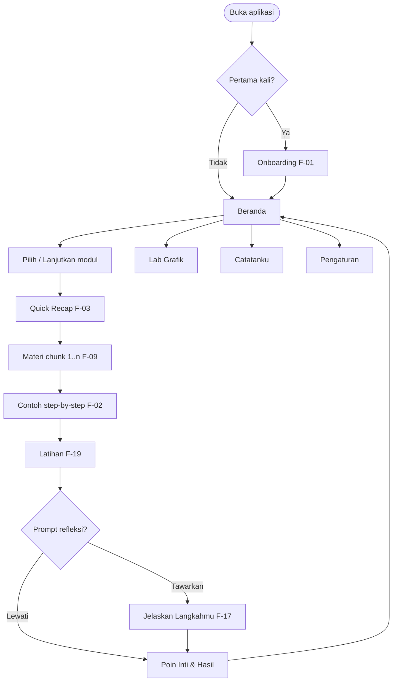
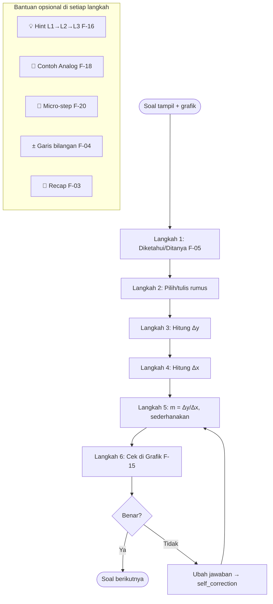
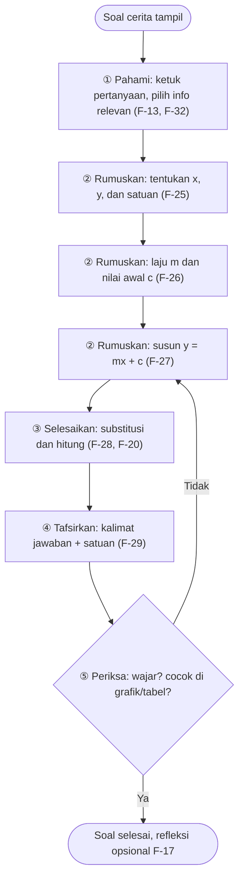
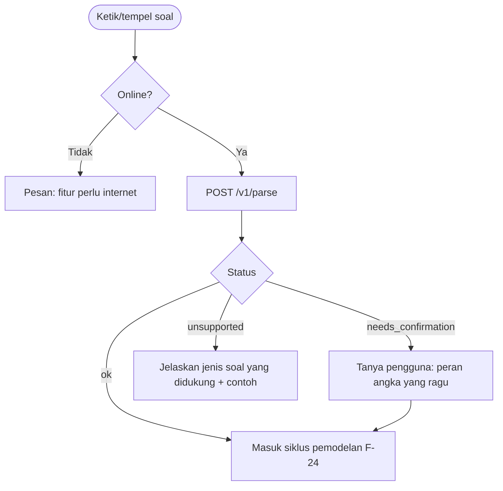

# Arsitektur Informasi dan Alur Navigasi

## 1. Peta Layar

| Rute | Layar | Fitur utama |
|---|---|---|
| `/onboarding` | Onboarding (4 layar) | F-01 |
| `/` | Beranda (daftar modul, lanjutkan) | F-23 |
| `/module/:id/recap` | Quick Recap | F-03 |
| `/module/:id/learn/:chunk` | Materi per chunk | F-09, F-11, F-12, F-06, F-07 |
| `/module/:id/example/:exId` | Contoh step-by-step | F-02 |
| `/module/:id/practice/:setId` | Latihan | F-04, F-05, F-10, F-13–F-16, F-18–F-21 |
| `/module/:id/reflect` | Jelaskan Langkahmu | F-17 |
| `/module/:id/summary` | Poin Inti & hasil | F-12 |
| `/module/M7/problem/:id` dan `/module/M8/problem/:id` | Soal cerita dengan siklus pemodelan 5 tahap | F-24–F-30, F-32 |
| `/stories` | Bank Soal Cerita (filter jenis T, konteks, level) | F-30 |
| `/model-my-problem` | Modelkan Soalku (input soal bebas, online) | F-31 |
| `/posing` | Buat Soal Ceritaku | F-33 |
| `/explore` | Lab Grafik (slider m/c bebas) | F-07, F-14 |
| `/notes` | Catatanku (refleksi tersimpan, poin inti) | F-17 |
| `/progress` | Progresku | F-23 |
| `/settings` | Pengaturan (ukuran huruf, mode warna, peringatan tanda, tingkat bantuan) | F-11, F-20, F-21 |
| `/research` | Mode Peneliti (tersembunyi) | F-22 |

*Bottom sheet* (bukan rute): Hint (F-16), Contoh Analog (F-18), Recap (F-03), Micro-step (F-20), Integer Helper (F-04).

## 2. Alur Utama

## 3. Alur Satu Soal (Gradien Dua Titik)

Setiap langkah: isi → **Cek** → umpan balik spesifik (errorClassifier) → benar: lanjut; salah: coba lagi (bantuan ditawarkan setelah 2 kali salah, tidak dipaksa).

## 3b. Alur Satu Soal Cerita (Siklus Pemodelan)

## 3c. Alur Modelkan Soalku (online)

## 4. Navigasi Global

- **Ponsel:** *top app bar* (kembali, judul, progres) + tombol navigasi bawah per layar. Tidak ada *bottom tab bar* di dalam modul agar fokus.
- **Beranda:** akses ke Lab Grafik, Catatanku, Progresku, dan Pengaturan.
- Tombol *back* Android = langkah sebelumnya. Keluar dari modul meminta konfirmasi; posisi otomatis tersimpan.

## 5. Status yang Disimpan

| Kunci | Isi |
|---|---|
| `onboardingDone` | boolean |
| `progress[moduleId]` | `{ status, lastChunk, practiceBest, completedAt }` |
| `settings` | `{ fontScale, colorMode, signWarning, helpLevel }` |
| `notes[]` | refleksi siswa |
| `posedProblems[]` | soal cerita buatan siswa (F-33) |
| `wordProblemProgress[id]` | `{ stageReached, completed, assisted }` |
| `research` | `{ participantCode, group, enabled }` |
| `events[]` | log analytics (IndexedDB) |
