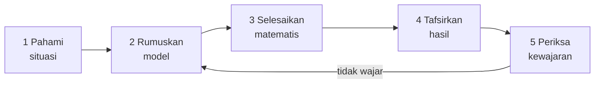

# Kerangka Literasi Matematika dan Pemodelan

Dokumen ini menjelaskan bagaimana GradieKAn **menumbuhkembangkan literasi matematika** siswa, terutama kemampuan **memodelkan soal cerita** ke dalam model matematika, menyelesaikannya, dan menafsirkan hasilnya. Spesifikasi teknis mesin pemodelan ada di [MODELING_ENGINE.md](MODELING_ENGINE.md).

## 1. Definisi

**Literasi matematika** (OECD, PISA 2022) adalah kemampuan individu untuk **bernalar secara matematis** serta **merumuskan, menerapkan, dan menafsirkan** matematika untuk memecahkan masalah dalam berbagai konteks dunia nyata.

Di Indonesia, kemampuan ini diukur melalui **AKM Numerasi** (Asesmen Kompetensi Minimum), yaitu kemampuan berpikir menggunakan konsep, prosedur, fakta, dan alat matematika untuk menyelesaikan masalah sehari-hari dalam berbagai konteks yang relevan.

GradieKAn memakai kedua kerangka ini secara bersamaan:

| Dimensi | PISA 2022 | AKM Numerasi | Penerapan di GradieKAn |
|---|---|---|---|
| **Konten** | *Change and relationships* | Aljabar (relasi & fungsi) | Gradien sebagai **laju perubahan**; model linear `y = mx + c` |
| **Proses / level kognitif** | *Formulate*, *Employ*, *Interpret & Evaluate*, + *Reasoning* | Pemahaman, Penerapan, Penalaran | Siklus pemodelan 5 tahap (§3) |
| **Konteks** | Personal, *occupational*, *societal*, *scientific* | Personal, Sosial-budaya, Saintifik | Bank soal kontekstual (§4) |

## 2. Gradien sebagai Jembatan ke Literasi

Gradien adalah konsep yang paling sering muncul dalam soal kontekstual SMP karena gradien = **laju perubahan**:

| Makna kontekstual gradien (m) | Contoh |
|---|---|
| Harga per satuan | Rp12.000 per kg |
| Tarif per jarak | Ojek daring Rp2.500 per km |
| Kecepatan | 60 km per jam |
| Laju pengisian/pengurangan | Tangki terisi 5 liter per menit; bensin berkurang 0,5 liter per 10 km |
| Pertumbuhan | Tanaman tumbuh 2 cm per minggu |
| Kemiringan fisik | Ramp kursi roda naik 1 m setiap 12 m mendatar |

Konstanta **c** bermakna **nilai awal**, misalnya biaya tetap, tabungan awal, tinggi awal, atau isi tangki mula-mula.

Dengan menghubungkan **m = laju** dan **c = nilai awal**, materi gradien (M1–M6) menjadi fondasi langsung bagi pemodelan soal cerita (M7–M8).

## 3. Siklus Pemodelan 5 Tahap

Diadaptasi dari siklus pemodelan Blum & Leiß (2007) dan proses PISA, lalu disederhanakan untuk siswa SMP. Setiap tahap tampil di **layar tersendiri** agar sesuai prinsip beban kognitif (satu langkah per layar).

| Tahap | Pertanyaan pemandu untuk siswa | Proses PISA | Level AKM | Fitur |
|---|---|---|---|---|
| **1. Pahami** | "Ceritanya tentang apa? Apa yang ditanyakan? Info mana yang penting?" | *Formulate* | Pemahaman | F-13 Sorot Info, F-32 Kamus Konteks |
| **2. Rumuskan** | "Apa yang berubah (x)? Apa yang bergantung (y)? Berapa lajunya (m)? Berapa nilai awalnya (c)?" | *Formulate* | Penerapan | F-25 Variabel & Satuan, F-26 Representasi Ganda, F-27 Pemeriksa Model |
| **3. Selesaikan** | "Substitusi, lalu hitung." | *Employ* | Penerapan | F-28 Penyelesai + micro-step (F-20) |
| **4. Tafsirkan** | "Apa arti angka ini dalam cerita? Satuannya apa?" | *Interpret* | Penalaran | F-29 |
| **5. Periksa** | "Masuk akal? Cocok dengan tabel/grafik? Ada batasannya?" | *Evaluate* | Penalaran | F-29, F-15 Cek di Grafik |

## 4. Taksonomi Soal Cerita

GradieKAn mendukung **berbagai jenis soal cerita** yang dapat dimodelkan dengan relasi linear. Setiap jenis memiliki kode yang dipakai oleh bank soal dan mesin pemodelan.

| Kode | Jenis model | Bentuk informasi di soal | Contoh konteks | Pertanyaan khas |
|---|---|---|---|---|
| **T1** | Proporsional `y = mx` | Laju saja | Harga per kg, kecepatan konstan | Total untuk x tertentu |
| **T2** | Laju + nilai awal | "biaya tetap Rp… ditambah Rp… per …" | Tarif taksi/ojek, langganan internet, tabungan | Model, prediksi y |
| **T3** | Dua data | Dua pasang (x, y) | "3 kg Rp36.000, 5 kg Rp56.000" | Laju, nilai awal, model |
| **T4** | Tabel | Tabel ≥ 3 baris | Tinggi tanaman per minggu | Pola, laju, prediksi |
| **T5** | Grafik | Grafik garis | Jarak–waktu perjalanan | Membaca laju, nilai awal |
| **T6** | Laju menurun (m < 0) | "berkurang", "turun" | Bensin, suhu malam, sisa cicilan | Kapan habis/nol (invers) |
| **T7** | Kemiringan fisik | Tinggi & jarak mendatar | Tangga, ramp, atap, jalan menanjak | Gradien, bandingkan kecuraman, persen kemiringan |
| **T8** | Invers | Diketahui y, dicari x | "Berapa km jika bayar Rp30.000?" | Nilai x |
| **T9** | Membandingkan dua model | Dua paket/rencana | Paket A vs paket B | Kapan sama (titik potong), mana lebih hemat |
| **T10** | Sejajar/tegak lurus | Dua lintasan | Jalan sejajar rel, tangga tegak lurus atap | Gradien lintasan kedua |

Jenis T1–T8 masuk modul M7. T9–T10 masuk modul M8 (level penalaran). Arsitektur mesin dibuat **dapat diperluas** ke model lain (mis. persamaan linear satu variabel, SPLDV, perbandingan) pada versi berikutnya.

## 5. Konteks dan Kompleksitas Teks Bertahap

Literasi menuntut siswa membaca teks yang kaya konteks. Namun, teks panjang menambah **beban ekstrinsik** (EL01, EL05). Penyelesaiannya adalah **kompleksitas konteks bertahap**: bantuan membaca dikurangi seiring terbentuknya skema siswa.

| Level konteks | Ciri teks/stimulus | Dukungan default |
|---|---|---|
| **K-A** Langsung | 1–2 kalimat, semua angka relevan, satuan sederhana | Sorot info aktif, variabel sudah diberi nama |
| **K-B** Cerita pendek | 3–4 kalimat, perlu memilih x dan y sendiri | Sorot info tersedia (opsional) |
| **K-C** Stimulus majemuk | Teks + tabel/grafik/infografis, ada **informasi pengecoh** yang tidak relevan, konversi satuan | Kamus konteks, *hint* |
| **K-D** Masalah terbuka | Keputusan/perbandingan, jawaban berupa argumen | *Hint* strategi saja |

Sebaran konteks dalam bank soal minimal: **Personal 40%, Sosial-budaya 35%, Saintifik 25%**, dengan konteks lokal Indonesia (angkot, ojek daring, pulsa/kuota, harga cabai di pasar, sawah terasering, tangga rumah panggung, tarif PDAM, dan sebagainya).

## 6. Bentuk Soal (selaras AKM)

| Bentuk | Contoh di GradieKAn |
|---|---|
| Pilihan ganda | Pilih model yang sesuai cerita |
| Pilihan ganda kompleks | Centang semua pernyataan yang benar tentang grafik |
| Menjodohkan | Pasangkan cerita ↔ grafik ↔ persamaan |
| Isian singkat | Nilai m, c, atau jawaban akhir |
| Uraian | Tafsirkan hasil / beri alasan (dinilai rubrik, tidak otomatis) |

## 7. Indikator Literasi Matematika

| Kode | Indikator | Tahap | Bukti di aplikasi |
|---|---|---|---|
| LM-1 | Mengidentifikasi informasi relevan dan pertanyaan dalam konteks | Pahami | `asked_tap`, `relevant_info_select` |
| LM-2 | Menentukan variabel bebas/terikat beserta satuannya | Rumuskan | `variable_define` |
| LM-3 | Mengenali laju (m) dan nilai awal (c) dari teks/tabel/grafik | Rumuskan | `model_submit` + `errorType` |
| LM-4 | Menyusun model matematika `y = mx + c` | Rumuskan | `model_submit.correct` |
| LM-5 | Menyelesaikan model (prediksi/invers/perbandingan) | Selesaikan | `solve_step_submit` |
| LM-6 | Menafsirkan hasil dalam konteks dengan satuan tepat | Tafsirkan | `interpret_submit` |
| LM-7 | Mengevaluasi kewajaran dan batasan model | Periksa | `reasonableness_answer` |
| LM-8 | Berpindah antarrepresentasi (teks, tabel, grafik, persamaan) | Semua | Soal menjodohkan, `representation_switch` |
| LM-9 | Mengomunikasikan penalaran | Tafsirkan/Periksa | `reflection_submit` (F-17), F-33 |

## 8. Rubrik Pemodelan (per soal uraian)

| Aspek | 0 | 1 | 2 |
|---|---|---|---|
| **Merumuskan** (LM-2–4) | Tidak ada model / tidak relevan | Model sebagian benar (mis. m benar, c salah) | Model lengkap dan benar dengan arti variabel |
| **Menerapkan** (LM-5) | Tidak ada penyelesaian | Prosedur benar, ada salah hitung | Penyelesaian benar |
| **Menafsirkan** (LM-6) | Angka tanpa makna | Makna benar tanpa satuan / kurang lengkap | Kalimat jawaban benar dengan satuan |
| **Mengevaluasi** (LM-7) | Tidak memeriksa | Memeriksa tanpa alasan | Memeriksa dengan alasan (grafik, tabel, batasan) |

Skor maksimum: 8 per soal.

Contoh penerapan rubrik ada pada dua soal *think-aloud* (Ojek ke Sekolah dan Bensin Motor Pak Wayan) di [ANALYTICS_RESEARCH_PLAN §2b](ANALYTICS_RESEARCH_PLAN.md). Tes literasi memakai campuran soal AKM resmi dan buatan sendiri (kisi-kisi di §3b dokumen yang sama).

## 9. Keterkaitan dengan Beban Kognitif

| Risiko literasi terhadap beban kognitif | Mitigasi | Riset |
|---|---|---|
| Teks panjang menaikkan EL | Sorot info, kamus konteks, satu tahap per layar | EL01, EL05 |
| Banyak unsur sekaligus (variabel, satuan, angka) menaikkan IL | Penentu variabel terpisah dari penyusunan model; warna peran | IL02 |
| Bilangan negatif pada laju menurun | Micro-step, peringatan tanda | IL01, IL04, DS02 |
| Siswa tidak yakin hasilnya benar | Cek di grafik/tabel pada tahap Periksa | GL02 |
| Siswa butuh pola penyelesaian | Contoh analog dengan jenis T yang sama | GL05 |
| Kebutuhan bantuan berbeda | Semua dukungan opsional; dikurangi bertahap K-A → K-D | DS03, GL03 |

## 10. Referensi

- Blum, W., & Leiß, D. (2007). How do students and teachers deal with modelling problems? Dalam C. Haines dkk. (Ed.), *Mathematical Modelling (ICTMA 12): Education, Engineering and Economics* (hlm. 222–231). Horwood.
- OECD. (2023). *PISA 2022 Assessment and Analytical Framework*. OECD Publishing.
- Pusat Asesmen dan Pembelajaran, Kemendikbud. (2020). *AKM dan Implikasinya pada Pembelajaran*.
- Verschaffel, L., Greer, B., & De Corte, E. (2000). *Making Sense of Word Problems*. Swets & Zeitlinger.

> Cocokkan rumusan definisi dan kerangka AKM dengan dokumen resmi terbaru dari Pusat Asesmen Pendidikan sebelum dikutip di laporan.
