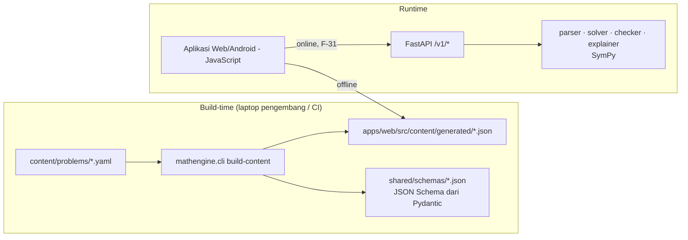

# Spesifikasi Mesin Pemodelan Soal Cerita (Python)

Mesin pemodelan (`services/math-engine/`, Python) bertugas **mengubah soal cerita menjadi model matematika, menyelesaikannya, memeriksa model buatan siswa, dan menghasilkan penjelasan langkah demi langkah** dalam bahasa Indonesia. Kerangka pedagogisnya ada di [MATH_LITERACY.md](MATH_LITERACY.md).

## 1. Dua Mode Kerja

| Mode | Kapan | Cara kerja | Butuh internet? |
|---|---|---|---|
| **Build-time (utama)** | Saat menyiapkan rilis | CLI Python membaca sumber soal (YAML), membangun model, menyelesaikan, membuat langkah & variasi jawaban yang diterima, lalu menulis JSON ke `apps/web/src/content/generated/` | Tidak (di sisi siswa) |
| **Runtime API (tambahan)** | Siswa/guru mengetik soal cerita baru (F-31) atau meminta pemeriksaan model bebas | FastAPI menerima teks/model → *parse* → *solve* → kirim JSON | Ya |

Seluruh pembelajaran inti **tetap berjalan offline** memakai bank soal hasil build. Hanya F-31 yang membutuhkan API.



## 2. Teknologi

| Bagian | Pilihan |
|---|---|
| Bahasa | Python 3.12 |
| Matematika simbolik | **SymPy** (aritmetika rasional eksak, `solve`, `simplify`, kesetaraan persamaan) |
| API | **FastAPI** + Uvicorn |
| Skema data | **Pydantic v2** (sumber tunggal; diekspor ke JSON Schema untuk JavaScript) |
| Parser bahasa | Berbasis aturan: *regex* + kamus kata kunci bahasa Indonesia (tanpa model AI) |
| Test | **pytest**; test *property-based* memakai perulangan `random` ber-*seed* (pustaka `hypothesis` diblokir Windows Smart App Control) |
| Kualitas kode | **ruff** (lint + format), **mypy** (opsional) |
| Lingkungan | `venv` + `pip` (`pyproject.toml`) |

## 3. Struktur Paket

```
services/math-engine/
├─ pyproject.toml
├─ mathengine/
│  ├─ schemas.py        # Pydantic: Quantity, Variable, LinearModel, WordProblem, Task, Solution, Step, Diagnosis
│  ├─ linear.py         # operasi model linear dengan sympy.Rational
│  ├─ solver.py         # menyelesaikan Task: find_rate, find_initial, predict, inverse, intersect, compare, steepness
│  ├─ checker.py        # memeriksa model/jawaban siswa → Diagnosis (errorType)
│  ├─ explainer.py      # menyusun langkah & micro-step berbahasa Indonesia
│  ├─ units.py          # satuan & konversi (m↔km, menit↔jam, Rp, liter, cm, %)
│  ├─ parser/
│  │  ├─ numbers.py     # "Rp12.000", "2,5", "dua belas", "setengah"
│  │  ├─ lexicon.py     # kata kunci: per, setiap, tiap, awal, mula-mula, biaya tetap, berkurang, turun, naik ...
│  │  ├─ patterns.py    # pola T1–T10
│  │  └─ extract.py     # teks → ParseResult (kandidat model + kepercayaan)
│  ├─ numfmt.py         # pecahan eksak (fractions.Fraction) & format angka Indonesia
│  ├─ content.py        # pembangun bank soal + variasi angka deterministik (seed) + anotasi
│  ├─ cli.py            # build-content, validate, export-schemas, parse
│  └─ api.py            # FastAPI
└─ tests/
   ├─ test_linear.py  test_solver.py  test_checker.py  test_parser.py  test_api.py
   └─ data/parser_corpus.yaml   # ≥ 100 soal cerita berlabel
```

## 4. Model Data (Pydantic, ringkas)

```python
class Quantity(BaseModel):
    value: Fraction            # disimpan sebagai string "p/q" saat diserialisasi
    unit: str                  # "km", "rupiah", "liter", "menit", "cm", "m"

class Variable(BaseModel):
    symbol: Literal["x", "y"]
    meaning: str               # "jarak tempuh"
    unit: str                  # "km"

class LinearModel(BaseModel):
    x: Variable
    y: Variable
    m: Fraction                # laju (satuan y per satuan x)
    c: Fraction                # nilai awal
    domain: tuple[Fraction | None, Fraction | None] = (None, None)   # mis. x ≥ 0

class Task(BaseModel):
    kind: Literal["find_rate", "find_initial", "build_model", "predict", "inverse",
                  "intersect", "compare", "steepness", "parallel", "perpendicular"]
    given: dict[str, Quantity] = {}

class WordProblem(BaseModel):
    id: str
    type: Literal["T1","T2","T3","T4","T5","T6","T7","T8","T9","T10"]
    context: Literal["personal", "sosial-budaya", "saintifik"]
    context_level: Literal["K-A","K-B","K-C","K-D"]
    cognitive_level: Literal["pemahaman","penerapan","penalaran"]
    text: str
    stimulus: Stimulus | None  # tabel / grafik / infografis
    annotations: Annotations   # rentang teks: known, asked, distractor
    models: list[LinearModel]  # 1 model, atau 2 untuk T9
    tasks: list[Task]

class Step(BaseModel):
    stage: Literal["pahami","rumuskan","selesaikan","tafsirkan","periksa"]
    text: str                  # bahasa Indonesia
    latex: str | None
    micro_steps: list[str] = []
    hints: tuple[str, str, str]

class Solution(BaseModel):
    answers: dict[str, Quantity | str]
    steps: list[Step]
    accepted_forms: list[str]  # bentuk persamaan setara yang diterima, mis. "y = 2500x + 5000", "y = 5000 + 2500x"
    interpretation: str        # "Biaya perjalanan 8 km adalah Rp25.000."
    reasonableness: list[str]  # pertanyaan/pernyataan cek kewajaran

class Diagnosis(BaseModel):
    correct: bool
    error_type: str | None     # lihat §7
    message: str               # umpan balik ramah, bahasa Indonesia
```

## 5. Alur Pemrosesan

### 5.1 `parse(text) → ParseResult`
1. **Normalisasi:** huruf kecil, angka Indonesia (`Rp12.000` → 12000, `2,5` → 5/2, "setengah" → 1/2).
2. **Ekstraksi besaran:** pasangan angka–satuan beserta posisi di teks.
3. **Klasifikasi peran** berdasarkan leksikon:
   - laju: "per", "setiap", "tiap", "untuk setiap", "/km", "per jam"
   - nilai awal: "awal", "mula-mula", "biaya tetap", "biaya buka pintu", "sudah ada", "tabungan awal"
   - arah turun: "berkurang", "turun", "menyusut", "dibayar/dicicil", "habis"
   - pertanyaan: kalimat berakhir "?" atau diawali "berapa", "kapan", "tentukan", "manakah"
4. **Pencocokan pola T1–T10** → kandidat `LinearModel` + `Task`.
5. **Skor kepercayaan** 0–1. Jika < 0,7 atau ada peran yang kosong, status menjadi `needs_confirmation`, disertai daftar pertanyaan untuk pengguna (mis. "Angka 5.000 ini biaya tetap atau biaya per km?").

Prinsip: **parser tidak boleh diam-diam salah.** Lebih baik bertanya daripada menebak. Hal ini sekaligus melatih siswa dalam tahap *Rumuskan*.

### 5.2 `solve(problem) → Solution`
- Semua hitungan memakai `sympy.Rational`.
- `find_rate` dari dua data: `m = (y2 − y1)/(x2 − x1)` dengan micro-step (dipakai ulang dari modul gradien).
- `find_initial`: `c = y1 − m·x1`.
- `predict`: `y = m·x + c`. `inverse`: `x = (y − c)/m`.
- `intersect` (T9): selesaikan `m1·x + c1 = m2·x + c2`, lalu tentukan model mana yang lebih kecil pada tiap selang.
- `steepness` (T7): `m = tinggi/jarak mendatar`, persen kemiringan `= m × 100%`, bandingkan dua kemiringan.
- Memeriksa domain: hasil x negatif untuk waktu/jarak ditandai **tidak wajar** dan dijadikan bahan tahap *Periksa*.

### 5.3 `check(problem, student_input) → Diagnosis`
Input siswa dapat berupa: peran variabel, nilai m dan c, persamaan teks (`y = 2500x + 5000`), jawaban akhir, atau kalimat tafsiran (pengecekan kata kunci satuan, tanpa penilaian otomatis penuh).

Kesetaraan persamaan diperiksa dengan SymPy (`simplify(lhs1 - rhs1 - k*(lhs2 - rhs2)) == 0`), sehingga `y = 5000 + 2500x` dan `2500x − y + 5000 = 0` sama-sama diterima.

### 5.4 `explain(problem) → list[Step]`
Menghasilkan langkah per tahap siklus pemodelan, 3 tingkat *hint* per langkah, dan micro-step aritmetika (mengikuti F-16 dan F-20).

## 6. API (FastAPI)

| Metode | Endpoint | Masukan | Keluaran |
|---|---|---|---|
| GET | `/health` | — | `{status, version}` |
| POST | `/v1/parse` | `{text}` | `ParseResult` |
| POST | `/v1/solve` | `WordProblem` atau `{model, tasks}` | `Solution` |
| POST | `/v1/check` | `{problem_id \| problem, stage, input}` | `Diagnosis` |
| POST | `/v1/explain` | `WordProblem` | `list[Step]` |

- **Privasi:** API tidak menerima kode peserta atau data identitas, dan tidak menyimpan teks soal (tanpa log isi permintaan).
- Batas ukuran teks 1.000 karakter; *rate limit* sederhana; CORS hanya untuk domain aplikasi.
- Waktu respons target < 500 ms (p95).
- Versi API di path (`/v1`) agar aplikasi Android lama tetap berfungsi.

## 7. Jenis Kesalahan Pemodelan (`errorType`)

| Kode | Kesalahan | Contoh | Umpan balik |
|---|---|---|---|
| `RATE_INITIAL_SWAP` | m dan c tertukar | `y = 5000x + 2500` | "Angka yang dikalikan x adalah biaya **per km**. Biaya tetap ditambahkan sekali saja." |
| `VAR_ROLE_SWAP` | x dan y tertukar | x = biaya, y = jarak | "Yang kamu pilih bebas (x) adalah jaraknya; biaya bergantung pada jarak." |
| `MISSING_INITIAL` | Lupa nilai awal | `y = 2500x` padahal ada biaya tetap | "Ada biaya yang dibayar di awal. Sudah dimasukkan?" |
| `SIGN_DIRECTION` | Laju positif padahal berkurang | Bensin `y = 0,5x + 40` | "Bensinnya *berkurang*, jadi lajunya negatif." |
| `UNIT_MISMATCH` | Satuan tidak dikonversi | Rp per 100 m dipakai per km | "Satuannya berbeda: per 100 m dan km. Samakan dulu." |
| `RATE_FROM_TOTAL` | Laju dihitung dari total, bukan selisih | m = 56.000/5 pada soal T3 | "Laju dihitung dari **selisih** dua data, bukan dari satu total." |
| `INTERPRET_NO_UNIT` | Jawaban tanpa satuan/makna | "25000" | "Angkanya benar. Tuliskan artinya: 25.000 rupiah untuk apa?" |
| `UNREASONABLE` | Hasil di luar domain | waktu = −3 jam | "Bisakah waktu bernilai negatif? Periksa lagi modelmu." |
| `ARITH_ERROR` | Salah hitung | — | "Model sudah benar. Coba 🔢 Hitung pelan-pelan." |

Kesalahan aritmetika lain memakai klasifikasi yang sama dengan [CONTENT_SPEC §8](CONTENT_SPEC.md).

## 8. Format Sumber Soal (YAML, ditulis manusia)

```yaml
- id: WP-T2-ojek-01
  type: T2
  context: personal
  context_level: K-B
  cognitive_level: penerapan
  text: >
    Tarif ojek daring di kota Rina adalah Rp5.000 untuk biaya awal,
    ditambah Rp2.500 setiap kilometer. Rina pergi ke sekolah sejauh 8 km.
    Berapa biaya yang harus dibayar Rina?
  model:
    x: {meaning: jarak tempuh, unit: km}
    y: {meaning: biaya, unit: rupiah}
    m: 2500
    c: 5000
    domain: [0, null]
  tasks:
    - {kind: build_model}
    - {kind: predict, given: {x: {value: 8, unit: km}}}
  reflection_prompt: "Mengapa biaya 0 km tidak sama dengan Rp0?"
  variants: {seed: 7, count: 5, vary: [m, c, x]}   # generator membuat 5 variasi angka
```

Saat `build-content`, CLI akan:
1. memvalidasi YAML dengan Pydantic;
2. memverifikasi **teks konsisten dengan model** dengan menjalankan parser dan membandingkan hasilnya (peringatan bila berbeda);
3. menyelesaikan semua tugas dan membuat langkah, *hint*, `accepted_forms`, dan tafsiran;
4. membuat variasi angka;
5. menulis JSON + `manifest.json` (versi, *hash*).

## 9. Kesetaraan Hasil JavaScript ↔ Python

Pemeriksaan jawaban saat offline dilakukan oleh JavaScript (`apps/web/src/math/`) memakai data hasil build. Agar kedua implementasi tidak berbeda:
- **Vektor uji bersama** di `shared/test-vectors/*.json` (input → output yang diharapkan) dijalankan oleh **pytest** dan **Vitest**.
- JSON Schema di `shared/schemas/` diekspor dari Pydantic (`mathengine.cli export-schemas`) dan dipakai Ajv di JavaScript.
- Bila Python dan JavaScript berbeda pendapat, **Python adalah acuan kebenaran**.

## 10. Target Kualitas

| Aspek | Target |
|---|---|
| Ketepatan solver pada bank soal | 100% (diverifikasi test) |
| Akurasi parser pada korpus uji (T1–T8, ≥ 100 soal) | ≥ 85% model benar; sisanya **harus** berstatus `needs_confirmation`, bukan salah diam-diam |
| Cakupan test `mathengine/` | ≥ 90% |
| Waktu `build-content` untuk 300 soal | < 60 detik |

## 11. Pengembangan Lanjutan (di luar v1)

- Model non-linear sederhana dan SPLDV penuh.
- Opsi *LLM* untuk membantu parsing teks bebas (perlu kajian privasi dan biaya; hasil tetap diverifikasi SymPy).
- Menjalankan mesin di perangkat lewat Pyodide (saat ini ditolak karena ukuran unduhan; lihat ADR-09).
