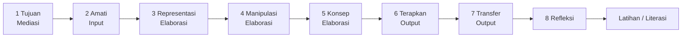

# Alur Belajar RMT (Rigorous Mathematical Thinking)

Dokumen ini memetakan model *Rigorous Mathematical Thinking* (RMT; Kinard & Kozulin) ke alur UI/UX GradieKAn.
Fitur: **F-35 Jalur RMT**. Kode: `apps/web/src/features/rmt/`, konten: `apps/web/src/content/rmt.id.js`.

RMT tidak menggantikan aturan beban kognitif di [CLAUDE.md §5](../CLAUDE.md). Keduanya dipakai bersama.
CLT menjaga beban tetap ringan: satu fase per layar, bantuan opsional, tanpa batas waktu.
RMT menentukan **urutan dan isi** fase: dari konsep sehari-hari menuju konsep ilmiah, dengan mediasi dan refleksi.

## 1. Ringkasan RMT yang dipakai

| Pilar RMT | Sumber | Wujud di aplikasi |
|---|---|---|
| Fungsi kognitif: **Input → Elaborasi → Output** | Feuerstein (Bab 4–5) | Fase dikelompokkan dan diberi label warna: Input (biru langit), Elaborasi (ungu), Output (hijau) |
| **Alat psikologis** spesifik matematika: tabel, garis bilangan, bidang koordinat, rumus, bahasa | Vygotsky (Bab 1, 3) | **Kotak Alat** di samping layar: Tabel, Bidang koordinat, Rumus, Kamus |
| **MLE**: intensionalitas, makna, transendensi | Feuerstein (Bab 4) | Fase *Tujuan* (tujuan + makna), fase *Transfer* (transendensi), panel **Pertanyaan Gradi** (mediasi) |
| **Konsep sehari-hari → konsep ilmiah** | Vygotsky / Davydov (Bab 3, 5) | Fase *Amati* (tangga, jalan, perosotan) → fase *Konsep* (m = Δy/Δx) |
| **Learning Activity**: analisis tugas, perencanaan, refleksi | Davydov (Bab 3) | Fase *Terapkan* dimulai dengan **memilih rencana**; fase *Refleksi* disimpan ke Catatan |
| Siklus penyelidikan: **Representasi → Manipulasi → Validasi** | Bab 6 (studi kasus SMP) | Fase *Representasi*, *Manipulasi*, dan langkah validasi grafik di *Terapkan* |
| Hindari **coba-coba** (*trial-and-error*) | Fase Output (Bab 4) | Dugaan wajib dibuat sebelum slider aktif; pilihan "tebak lalu cek" diberi umpan balik |
| **Asesmen dinamis** (petunjuk bertahap) | LPAD, ZPD (Bab 3–4) | Pertanyaan Gradi dibuka satu per satu; tercatat sebagai bantuan |

## 2. Delapan fase Jalur RMT (satu fase per layar)

| # | Fase | Kelompok | Tugas siswa | Alasan RMT |
|---|---|---|---|---|
| 1 | Tujuan | Mediasi | Membaca tujuan dan makna, lalu menekan "Aku siap!" | MLE: intensionalitas & pemberian makna |
| 2 | Amati | Input | Membandingkan tiga benda (naik & jalan); memilih yang paling curam | Pengumpulan data teliti; pengecoh "paling tinggi ≠ paling curam" |
| 3 | Representasi | Elaborasi | Menghitung naik ÷ jalan di tabel; melihat garisnya di bidang koordinat | Alat psikologis: tabel & bidang koordinat |
| 4 | Manipulasi | Elaborasi | Membuat dugaan, lalu menggeser Δx (Δy dibuat tetap) dan membandingkan | Penalaran hipotetis; variabel terkontrol |
| 5 | Konsep | Elaborasi | Memilih definisi yang tepat; melihat bahasa formal m = Δy/Δx | Konsep ilmiah & bahasa matematika |
| 6 | Terapkan | Output | Memilih rencana → menghitung Δy, Δx, m → memvalidasi di grafik | Perencanaan tindakan; ketepatan; validasi |
| 7 | Transfer | Output | Menemukan laju pada tarif ojek (y = 2000x + 5000) | MLE: transendensi ke konteks baru (literasi) |
| 8 | Refleksi | Refleksi | Menjawab 3 pertanyaan metakognitif; disimpan ke Catatan | Metakognisi & regulasi diri (jurnal RMT) |

Tombol **Lanjut** terkunci sampai tugas fase selesai. Siswa boleh kembali ke fase mana pun yang sudah dibuka.



## 3. Susunan menu mengikuti RMT

Urutan menu di Beranda dan menu samping kini mengikuti alur RMT:

| Urutan | Menu | Peran dalam RMT |
|---|---|---|
| 1 | **Materi** (berisi kartu **Jalur RMT** di paling atas) | Pembentukan konsep (Input → Elaborasi) |
| 2 | **Lab Grafik** | Alat psikologis untuk manipulasi bebas (Elaborasi) |
| 3 | **Latihan** | Output: menerapkan konsep dengan tepat |
| 4 | **Literasi** (soal cerita) | Transendensi: konsep dipakai di konteks baru |
| 5 | **Catatan** | Jurnal refleksi (metakognisi) |
| 6 | **Tanya AI** | Mediator (MLE) di luar jalur |
| 7 | Pengaturan | — |

Siklus 5 tahap soal cerita (Pahami → Rumuskan → Selesaikan → Tafsirkan → Periksa) tetap dipakai.
Siklus ini sudah sejalan dengan RMT: Pahami = Input; Rumuskan = Elaborasi/representasi; Selesaikan = manipulasi; Tafsirkan + Periksa = Output/validasi.

## 4. Struktur komponen

```
apps/web/src/
├─ content/rmt.id.js                 RMT_PHASES, RMT_TEXT, RMT_LESSONS (semua teks siswa)
└─ features/rmt/
   ├─ RmtLessonScreen.jsx            rute /belajar/:id — mengatur fase, progres, kunci Lanjut
   ├─ RmtPathCard.jsx                kartu pintu masuk di halaman Materi
   ├─ aiTutor.js                     adaptor Mediator AI (placeholder, enabled: false)
   ├─ components/
   │  ├─ PhaseStepper.jsx            8 fase, warna per kelompok Input/Elaborasi/Output
   │  ├─ MediatorPanel.jsx           Pertanyaan Gradi (dibuka satu per satu) + AiTutorSlot
   │  ├─ AiTutorSlot.jsx             UI Mediator AI (sudah jadi, menunggu koneksi)
   │  ├─ ToolBox.jsx                 Kotak Alat: Tabel, Bidang koordinat, Rumus, Kamus
   │  ├─ situationColors.js          warna garis (dari token, selalu berlabel)
   │  └─ ui.jsx                      Card, Btn, Feedback, ChoiceList, NumberField
   └─ phases/
      ├─ PhaseTujuan.jsx  PhaseAmati.jsx  PhaseRepresentasi.jsx  PhaseManipulasi.jsx
      └─ PhaseKonsep.jsx  PhaseTerapkan.jsx  PhaseTransfer.jsx    PhaseRefleksi.jsx
```

Kontrak setiap komponen fase: `({ lesson, completed, onComplete, notes, setNote }) => JSX`.
Untuk menambah jalur baru (mis. sejajar & tegak lurus), cukup tambahkan objek baru di `RMT_LESSONS`.
Komponen fase bisa dipakai ulang bila bentuk datanya sama.

Progres disimpan lokal di `state.rmt[lessonId] = { phase, done, notes, finished }` (tanpa server).
Angka diperiksa eksak dengan `checkNumber` (pecahan), sama seperti Latihan.

Gaya: **Tailwind CSS v3** hanya untuk `src/features/**` (ADR-12), dengan preflight mati.
Reset garis pinggir hanya berlaku di dalam `.rmt-scope`, supaya tampilan lama tidak berubah.

## 5. Kesesuaian dengan aturan desain (CLAUDE.md §5)

| Aturan | Penerapan di Jalur RMT |
|---|---|
| Satu langkah per layar | Satu fase per layar; langkah di dalam fase muncul bertahap |
| Tanpa tekanan waktu | Tidak ada pengatur waktu |
| Bantuan opsional | Pertanyaan Gradi, Kotak Alat, dan Mediator AI hanya dibuka atas permintaan |
| Warna variabel konsisten | Δy magenta, Δx sian, m/laju hijau, c/nilai awal ungu, titik 1 biru, titik 2 oranye |
| Bisa diperiksa di grafik | Representasi, Manipulasi, dan Terapkan selalu menampilkan grafik |
| Gambar dulu, rumus kemudian | Rumus formal baru muncul di fase 5, setelah amati–representasi–manipulasi |
| Umpan balik spesifik | Setiap pilihan salah punya penjelasan sendiri; angka memakai `checkNumber` |

## 6. Mediator AI (Gemini)

`AiTutorSlot` di setiap fase memanggil `features/rmt/aiTutor.js` → `POST /api/v1/ask` dengan
`{ question, history, context: { lesson, phase } }`.

- **Produksi:** Supabase Edge Function `api` (Gemini). `ai/prompt.ts` menambahkan peran mediator sesuai fase:
  pertanyaan penuntun, kaitan dengan tujuan fase, dan dorongan membuat rencana/dugaan sebelum menghitung.
  Lihat [DEPLOYMENT.md](DEPLOYMENT.md).
- **Lokal:** server Python (`mathengine/tutor.py`) menerima `context` yang sama.
- Kunci API hanya di server. Yang dikirim hanya pertanyaan, riwayat singkat, dan id fase. Kode peserta ditolak (422).
- Database mencatat jumlah permintaan per fase (tanpa teks), untuk melihat fase mana yang paling butuh bantuan.

## 7. Keterbatasan dan langkah berikutnya

- Baru satu jalur (`gradien`, mencakup M1–M4). Modul M5–M6 (persamaan, sejajar/tegak lurus) belum memakai jalur RMT.
- Isi fase masih ditulis di JavaScript. Bila jalur bertambah, pindahkan ke YAML dan bangun lewat Python agar konsisten dengan bank soal.
- Event analitik (`track()`) belum ada di repo (`src/analytics/` belum dibuat); data penggunaan Pertanyaan Gradi belum tercatat.
- Peran guru sebagai mediator (MLE manusia) belum didukung di aplikasi; dasbor guru baru menampilkan progres.
