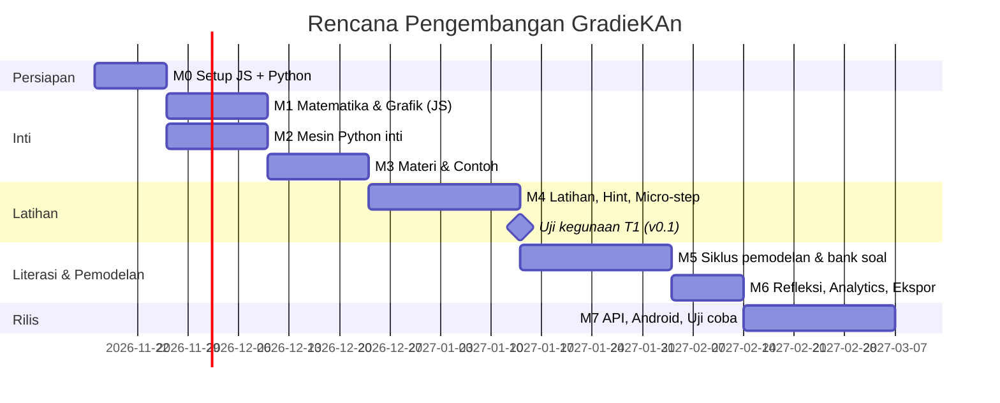

# Roadmap dan Checklist Pengerjaan

Estimasi durasi mengasumsikan 1 pengembang paruh waktu (± 10–15 jam/minggu). Sesuaikan dengan jadwal semester. Bahasa: **JavaScript** (aplikasi) dan **Python** (mesin matematika).

---

## M0 Setup Proyek (± 1,5 minggu)
**JavaScript**
- [ ] Inisialisasi repositori Git, `.gitignore` (node_modules, .venv, dist, android/build)
- [x] Node.js terpasang (v26, via winget)
- [x] Root `package.json` dengan *workspaces* dan skrip `dev:web`, `build:web`, `dev:api`, `build:content`, `test:*`, `lint:py`
- [x] `apps/web` (Vite + React, JavaScript) + PWA `vite-plugin-pwa` (nama **GradieKAn**, offline) + Vitest
- [ ] Tampilan final mengikuti foto UI/UX (menunggu foto); ikon PNG 192/512 untuk Android/iOS
- [ ] Pasang Tailwind, React Router, Zustand, Dexie, KaTeX, Ajv, vite-plugin-pwa
- [ ] ESLint + Prettier, Vitest, Playwright
- [ ] `src/styles/tokens.js` sesuai [UX_UI_GUIDELINES §3](UX_UI_GUIDELINES.md)
- [ ] Capacitor: `npx cap add android`; halaman kosong berjalan di ponsel

**Python**
- [x] `services/math-engine/pyproject.toml` (sympy, fastapi, uvicorn, pydantic, pyyaml; dev: pytest, httpx, ruff)
- [x] `venv` + `pip install -e ".[dev]"`; `pytest` dan `ruff` berjalan
- [x] Kerangka `mathengine/` sesuai [MODELING_ENGINE §3](MODELING_ENGINE.md)
- [x] `cli.py export-schemas` → `shared/schemas/`
- [x] `.gitignore`, root `package.json` (skrip Python), `scripts/py.mjs`, `Dockerfile` API

**Umum**
- [ ] CI GitHub Actions (job python + job web)
- [ ] Simpan PDF wawancara di `docs/research/` (jangan di-*commit* jika berisi foto siswa)

## M1 Inti Matematika & Bidang Kartesius, JavaScript (± 2 minggu)
- [x] `math/fraction.js` (BigInt eksak), `slope.js`, `equation.js`, `modelCheck.js` (F-27 offline) + vektor bersama VEC-01 di Vitest
- [ ] `math/line.js` + UNIT-02, 05, 08
- [ ] `math/errorClassifier.js` + UNIT-04
- [ ] `math/generator.js` (*seeded*) + UNIT-07
- [ ] `shared/test-vectors/` awal + runner Vitest (VEC-01)
- [ ] `CartesianPlane`, `DraggablePoint`, `LineSegment` (F-14)
- [ ] `RiseRunOverlay` (F-06), `SlopeSlider` + Lab Grafik (F-07)
- [ ] `ColoredVar`, `MathText`, `NumberLine`, `ValueTable`
- [ ] Uji *drag* di ponsel Android

## M2 Mesin Python Inti (± 2 minggu, paralel dengan M1)
- [x] `schemas.py` (Pydantic) + ekspor JSON Schema
- [x] `linear.py`, `units.py`, `numfmt.py` + PY-01
- [x] `solver.py` T1–T10 (termasuk T9–T10 lebih awal) + PY-02
- [x] `checker.py` + PY-03, PY-04
- [x] `explainer.py` (langkah 5 tahap, 3 *hint*, micro-step)
- [ ] PY-07: linter panjang kalimat penjelasan (≤ 25 kata) belum dibuat
- [x] Variasi angka deterministik (di `content.py`)
- [x] `cli.py build-content` + PY-06; 11 soal cerita YAML contoh (+ 8 variasi)
- [x] Runner vektor bersama di pytest (VEC-01); runner Vitest menyusul di M1
- [x] Parser awal (T1, T2, T3, T6, T7, T8) + API FastAPI, lebih awal dari jadwal M7. Korpus 100 soal untuk PY-05 belum dibuat

## M3 Materi & Contoh (± 2 minggu)
- [ ] Tulis konten JSON M0–M6 sesuai [CONTENT_SPEC](CONTENT_SPEC.md), termasuk soal kontekstual K-A/K-B
- [ ] Validasi Ajv (UNIT-09)
- [ ] Onboarding (F-01), Beranda + progres
- [ ] `LessonScreen` + `KeyPoint` + navigasi *self-paced* & *resume* (F-09, F-12)
- [ ] Quick Recap (F-03), Contoh step-by-step (F-02), Perbandingan persamaan (F-08)
- [ ] Validasi konten oleh dosen/guru

## M4 Latihan, Hint, Micro-step (± 3 minggu)
- [ ] `stepEngine.js` + `StepRunner` (F-10)
- [ ] `KnownAskedForm` (F-05), `NumericKeypad`
- [ ] Validasi per langkah + umpan balik (F-04)
- [ ] `MicroStep` + tooltip ⚠ (F-20)
- [ ] `hintEngine.js` + `HintSheet` + *fading* (F-16) + UNIT-06
- [ ] `AnalogSheet` (F-18), Cek di Grafik (F-15), Sorot Info (F-13)
- [ ] `HelpBar` (F-21), set latihan *fading* (F-19)
- [ ] E2E-01, 02, 03
- [ ] Siapkan Soal 1 (Ojek) & Soal 2 (Bensin) di kertas, lembar observasi, dan izin rekam ([ANALYTICS_RESEARCH_PLAN §2b](ANALYTICS_RESEARCH_PLAN.md))
- [ ] **Rilis v0.1 → Uji kegunaan T1 (3–5 siswa), termasuk 2 soal cerita *think-aloud***

## M5 Siklus Pemodelan & Bank Soal Literasi (± 3 minggu)
- [ ] Revisi berdasarkan temuan T1
- [ ] `modelingFlow.js` + `ModelingStepper` (F-24)
- [ ] `VariableBuilder` (F-25)
- [ ] `MultiRepresentation` cerita–tabel–grafik–persamaan + soal menjodohkan (F-26)
- [ ] `EquationInput` + `modelCheck.js` (F-27) + UNIT-10
- [ ] Tahap Selesaikan + penyelesaian lengkap (F-28)
- [ ] `InterpretForm` + `ReasonablenessCheck` (F-29)
- [ ] `ContextGlossary` + `content/glossary.yaml` (F-32)
- [ ] Solver T9–T10 (Python) + modul M8
- [ ] Tulis **60 soal cerita** (v0.5) → **120 soal** (v1.0) sesuai komposisi F-30; tinjau oleh guru
- [ ] Modul M7 & M8, Bank Soal Cerita dengan filter
- [ ] E2E-06

## M6 Refleksi, Analytics, Ekspor (± 1,5 minggu)
- [ ] "Jelaskan Langkahmu" + Catatanku (F-17)
- [ ] `analytics/track` di semua event, termasuk event pemodelan ([ANALYTICS_RESEARCH_PLAN §4](ANALYTICS_RESEARCH_PLAN.md))
- [ ] Mode Peneliti, skala Paas, ekspor CSV/JSON (F-22)
- [ ] Progresku + Literasiku (F-23)
- [ ] Pengaturan (ukuran huruf, mode warna, peringatan tanda, tingkat bantuan)
- [ ] E2E-04, 05
- [ ] **Rilis v0.5**

## M7 API, Android, Uji Coba (± 3 minggu)
**Python API**
- [ ] `parser/` + korpus 100 soal berlabel + PY-05 (akurasi ≥ 85%)
- [ ] `api.py` FastAPI `/v1/*` + API-01; `Dockerfile`
- [ ] Deploy API (layanan gratis / server kampus); atur CORS & *rate limit*

**JavaScript**
- [ ] `api/client.js` + Modelkan Soalku (F-31) + E2E-07
- [ ] Buat Soal Ceritaku (F-33)
- [ ] Ikon, *splash*, checklist perangkat ([TEST_PLAN §5](TEST_PLAN.md)), APK bertanda tangan
- [ ] Deploy PWA

**Riset**
- [ ] Kumpulkan contoh soal AKM Numerasi resmi SMP yang relevan; catat sumbernya di `docs/research/sumber-soal-akm.md`
- [ ] Tulis 8 soal literasi buatan sendiri per paket sesuai kisi-kisi ([ANALYTICS_RESEARCH_PLAN §3b](ANALYTICS_RESEARCH_PLAN.md))
- [ ] Validasi ahli (Aiken's V), uji keterbacaan, uji coba empiris (reliabilitas, kesukaran, daya beda), dan cek kesetaraan paket A/B
- [ ] Finalkan rubrik pemodelan
- [ ] Validasi ahli materi & media (T2) → uji coba terbatas (T3) → revisi
- [ ] **Rilis v1.0** → uji efektivitas (T4)

---

## Backlog v1.1+
- Mode gelap
- Rumus `y − y₁ = m(x − x₁)` dan SPLDV penuh
- Soal cerita non-linear sederhana
- Opsi LLM untuk parser (dengan kajian privasi; hasil diverifikasi SymPy)
- Dasbor guru (gabungan file ekspor)
- Bahasa daerah / Inggris
